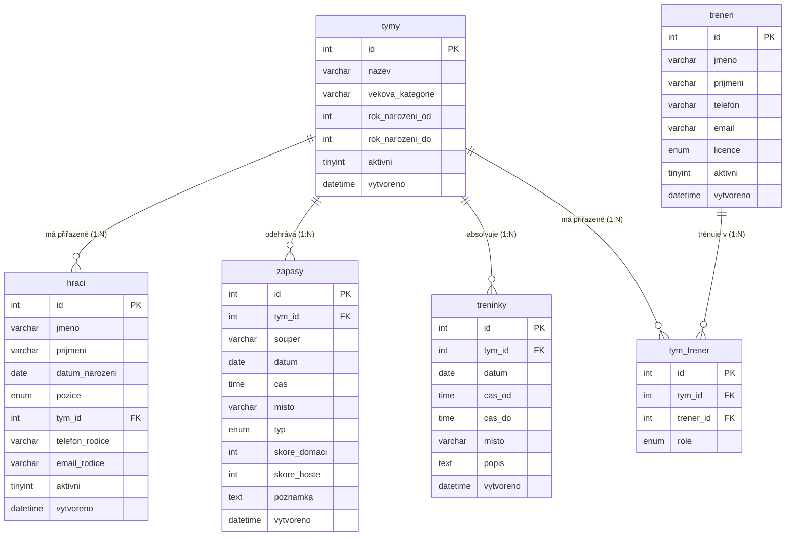

# FK Náchod – ER diagram a návrh relační databáze

## 1. Konceptuální model a vztahy mezi entitami

Databáze informačního systému mládežnického fotbalového klubu **FK Náchod** se skládá ze **6 provázaných tabulek**, které plně pokrývají potřeby klubu: správu kategorií (týmů), trenérů, hráčů, tréninkových jednotek a mistrovských zápasů.

---

## 2. Podrobný popis jednotlivých tabulek

### Tabulka `tymy`
Reprezentuje jednotlivá mládežnická družstva rozdělená podle věkových kategorií FAČR.
- **id** (`INT`, PK, Auto-Increment) – Unikátní identifikátor týmu.
- **nazev** (`VARCHAR(100)`, NOT NULL) – Plný název týmu (např. *FK Náchod U13*).
- **vekova_kategorie** (`VARCHAR(10)`, NOT NULL) – Zkratka kategorie (*U11*, *U13*, *U15*, *U17*).
- **rok_narozeni_od** (`INT`, NOT NULL) – Nejstarší povolený ročník pro danou kategorii (klíčové pro aplikační logiku).
- **rok_narozeni_do** (`INT`, NOT NULL) – Nejmladší povolený ročník.
- **aktivni** (`TINYINT(1)`, DEFAULT 1) – Příznak aktivního/archivního družstva.
- **vytvoreno** (`DATETIME`, DEFAULT CURRENT_TIMESTAMP) – Časová známka vytvoření záznamu.

### Tabulka `treneri`
Evidence trenérského personálu klubu.
- **id** (`INT`, PK, Auto-Increment) – Identifikátor trenéra.
- **jmeno** (`VARCHAR(50)`, NOT NULL) – Křestní jméno trenéra.
- **prijmeni** (`VARCHAR(50)`, NOT NULL) – Příjmení trenéra.
- **telefon** (`VARCHAR(20)`) – Telefonní kontakt.
- **email** (`VARCHAR(100)`) – E-mailový kontakt.
- **licence** (`ENUM('C','B','UEFA_B','A','UEFA_A','PRO')`, NOT NULL) – Dosažená trenérská kvalifikace.
- **aktivni** (`TINYINT(1)`, DEFAULT 1) – Status trenéra v klubu.
- **vytvoreno** (`DATETIME`, DEFAULT CURRENT_TIMESTAMP).

### Tabulka `tym_trener` (vazební tabulka M:N)
Umožňuje přiřadit k jednomu týmu více trenérů (např. hlavní trenér + asistent) a zároveň jednomu trenérovi působit u více družstev.
- **id** (`INT`, PK, Auto-Increment).
- **tym_id** (`INT`, FK) – Odkaz na `tymy(id)`, `ON DELETE CASCADE`.
- **trener_id** (`INT`, FK) – Odkaz na `treneri(id)`, `ON DELETE CASCADE`.
- **role** (`ENUM('hlavni', 'asistent')`, NOT NULL) – Pozice trenéra v realizačním týmu.
- *Unikátní klíč:* `UNIQUE KEY (tym_id, trener_id)` zabraňuje duplicitnímu přiřazení stejného trenéra k jednomu týmu.

### Tabulka `hraci`
Centrální evidence mládežnických fotbalistů.
- **id** (`INT`, PK, Auto-Increment) – Identifikátor hráče.
- **jmeno** (`VARCHAR(50)`, NOT NULL) – Jméno hráče.
- **prijmeni** (`VARCHAR(50)`, NOT NULL) – Příjmení hráče.
- **datum_narozeni** (`DATE`, NOT NULL) – Datum narození (využívá se pro kontrolu ročníku a výpočet věku).
- **pozice** (`ENUM('brankář','obránce','záložník','útočník')`, NOT NULL) – Herní post.
- **tym_id** (`INT`, FK, NULLABLE) – Cizí klíč na `tymy(id)`, při smazání týmu se nastaví `ON DELETE SET NULL` (hráč zůstává v databázi jako volný).
- **telefon_rodice** (`VARCHAR(20)`) – Kontakt na zákonného zástupce.
- **email_rodice** (`VARCHAR(100)`) – E-mail zákonného zástupce.
- **aktivni** (`TINYINT(1)`, DEFAULT 1) – Aktivní hráč / přerušená činnost.
- **vytvoreno** (`DATETIME`, DEFAULT CURRENT_TIMESTAMP).

### Tabulka `zapasy`
Rozpis a výsledky mistrovských a přátelských utkání.
- **id** (`INT`, PK, Auto-Increment) – Identifikátor zápasu.
- **tym_id** (`INT`, FK, NOT NULL) – Tým klubu, který utkání hraje (`ON DELETE CASCADE`).
- **souper** (`VARCHAR(100)`, NOT NULL) – Název soupeře.
- **datum** (`DATE`, NOT NULL) – Den konání zápasu.
- **cas** (`TIME`) – Čas výkopu.
- **misto** (`VARCHAR(150)`) – Stadion / hřiště.
- **typ** (`ENUM('domácí','venkovní')`, NOT NULL) – Určení domácího/venkovního prostředí pro správný výpočet statistik výher/proher.
- **skore_domaci** (`INT`, NULLABLE) – Počet vstřelených branek domácího celku (NULL = neodehráno).
- **skore_hoste** (`INT`, NULLABLE) – Počet vstřelených branek hostujícího celku.
- **poznamka** (`TEXT`) – Doplňující záznam k utkání.
- **vytvoreno** (`DATETIME`, DEFAULT CURRENT_TIMESTAMP).

### Tabulka `treninky`
Rozvrh tréninkových jednotek pro jednotlivé kategorie.
- **id** (`INT`, PK, Auto-Increment) – Identifikátor tréninku.
- **tym_id** (`INT`, FK, NOT NULL) – Kategorie, pro kterou je trénink určen (`ON DELETE CASCADE`).
- **datum** (`DATE`, NOT NULL) – Datum tréninku.
- **cas_od** (`TIME`, NOT NULL) – Začátek jednotky.
- **cas_do** (`TIME`, NOT NULL) – Konec jednotky.
- **misto** (`VARCHAR(150)`, NOT NULL) – Např. *Hlavní hřiště FK Náchod*, *Umělá tráva*.
- **popis** (`TEXT`) – Tréninkové zaměření (např. *Herní cvičení, nácvik standardních situací*).
- **vytvoreno** (`DATETIME`, DEFAULT CURRENT_TIMESTAMP).

---

## 3. Relační integrita a cizí klíče

Všechny tabulky používají moderní úložiště **InnoDB**, které podporuje transakce (ACID) a garantuje **referenční integritu**:
1. `hraci.tym_id -> tymy.id`: Při smazání týmu se hráči nesmažou, ale hodnota se nastaví na `NULL` (`ON DELETE SET NULL`).
2. `zapasy.tym_id -> tymy.id`: Smazáním týmu se kaskádovitě smažou i jeho zápasy (`ON DELETE CASCADE`).
3. `treninky.tym_id -> tymy.id`: Kaskádové smazání tréninků týmu (`ON DELETE CASCADE`).
4. `tym_trener.tym_id -> tymy.id` a `tym_trener.trener_id -> treneri.id`: Kaskádové smazání přiřazení (`ON DELETE CASCADE`).

Databáze je kódována v moderní sadě **`utf8mb4`** s kolací **`utf8mb4_czech_ci`**, což zaručuje správné české řazení (např. písmena Č, Š, Ž, Ch).
