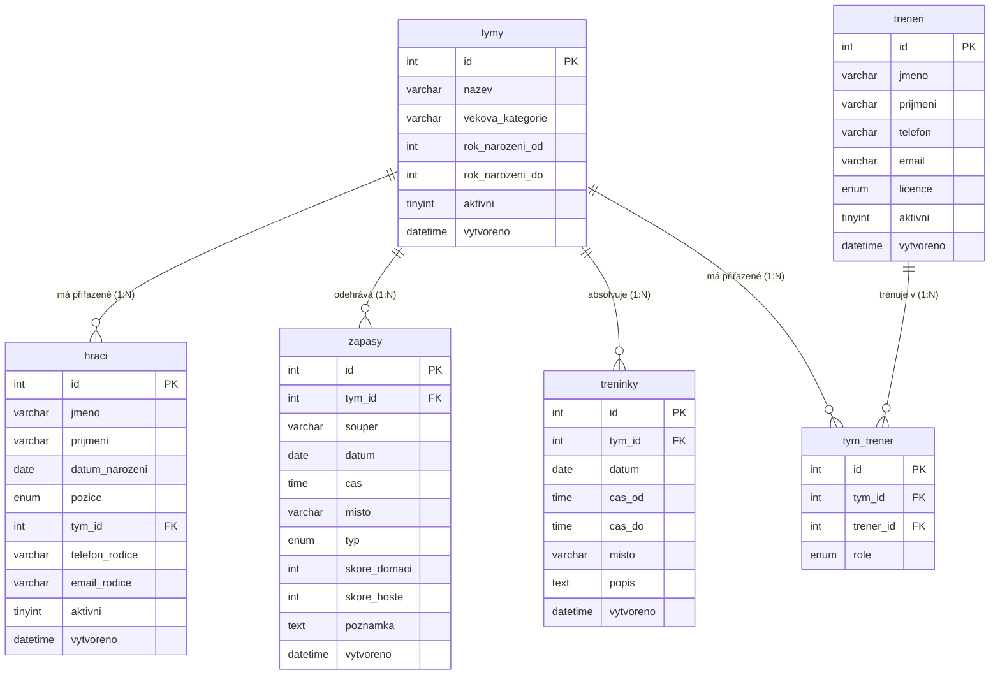

# FK Náchod – ER diagram a návrh relační databáze

## 1. Konceptuální model a vztahy mezi entitami

Databáze informačního systému mládežnického fotbalového klubu **FK Náchod** se skládá ze **6 provázaných tabulek**, které plně pokrývají potřeby klubu: správu kategorií (týmů), trenérů, hráčů, tréninkových jednotek a mistrovských zápasů.

---

## 2. Podrobný popis jednotlivých tabulek

### Tabulka `tymy`
Reprezentuje jednotlivá mládežnická družstva rozdělená podle věkových kategorií FAČR.
- **id** (`INT`, PK, Auto-Increment) – Unikátní identifikátor týmu.
- **nazev** (`VARCHAR(100)`, NOT NULL) – Plný název týmu (např. *FK Náchod U13*).
- **vekova_kategorie** (`VARCHAR(10)`, NOT NULL) – Zkratka kategorie (*U11*, *U13*, *U15*, *U17*).
- **rok_narozeni_od** (`INT`, NOT NULL) – Nejstarší povolený ročník pro danou kategorii (klíčové pro aplikační logiku).
- **rok_narozeni_do** (`INT`, NOT NULL) – Nejmladší povolený ročník.
- **aktivni** (`TINYINT(1)`, DEFAULT 1) – Příznak aktivního/archivního družstva.
- **vytvoreno** (`DATETIME`, DEFAULT CURRENT_TIMESTAMP) – Časová známka vytvoření záznamu.

### Tabulka `treneri`
Evidence trenérského personálu klubu.
- **id** (`INT`, PK, Auto-Increment) – Identifikátor trenéra.
- **jmeno** (`VARCHAR(50)`, NOT NULL) – Křestní jméno trenéra.
- **prijmeni** (`VARCHAR(50)`, NOT NULL) – Příjmení trenéra.
- **telefon** (`VARCHAR(20)`) – Telefonní kontakt.
- **email** (`VARCHAR(100)`) – E-mailový kontakt.
- **licence** (`ENUM('C','B','UEFA_B','A','UEFA_A','PRO')`, NOT NULL) – Dosažená trenérská kvalifikace.
- **aktivni** (`TINYINT(1)`, DEFAULT 1) – Status trenéra v klubu.
- **vytvoreno** (`DATETIME`, DEFAULT CURRENT_TIMESTAMP).

### Tabulka `tym_trener` (vazební tabulka M:N)
Umožňuje přiřadit k jednomu týmu více trenérů (např. hlavní trenér + asistent) a zároveň jednomu trenérovi působit u více družstev.
- **id** (`INT`, PK, Auto-Increment).
- **tym_id** (`INT`, FK) – Odkaz na `tymy(id)`, `ON DELETE CASCADE`.
