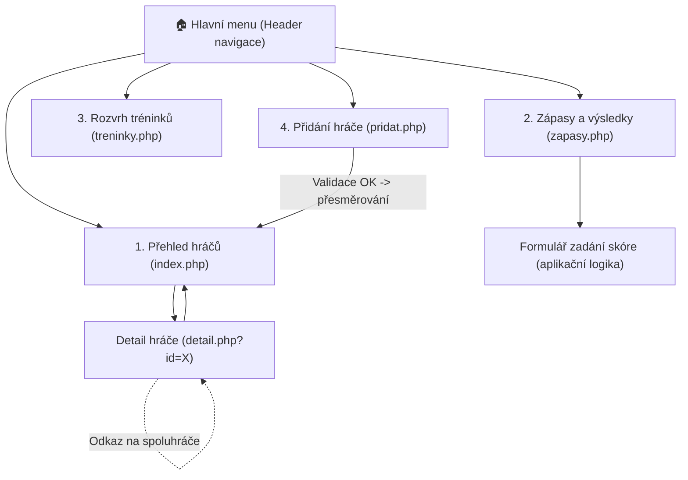

# FK Náchod – Wireframy a architektura webu

Dokument obsahuje grafické návrhy (wireframy) klíčových stránek webové aplikace pro **FK Náchod**, včetně informační architektury a mapy stránek.

---

## 1. Mapa stránek a struktura navigace (Sitemap)

Aplikace využívá přehlednou stromovou strukturu s globálním navigačním panelem přístupným na všech podstránkách.



### Globální prvky navigace
- **Header:** Logo klubu ⚽ `FK Náchod – Mládež`, odkazy na hlavní sekce s indikátorem aktivní stránky.
- **Footer:** Informace o autorských právech, ročníku projektu a škole SPŠE Litomyšl.

---

## 2. Wireframe 1: Přehled hráčů (`index.php`)

Tato stránka slouží jako výchozí bod systému. Obsahuje interaktivní filtr podle kategorií a přehlednou tabulku s vizuálními štítky (badges).

```
+-----------------------------------------------------------------------------------+
|  ⚽ FK Náchod – Mládež        [Hráči]   [Zápasy]   [Tréninky]   [+ Přidat hráče]  |
+-----------------------------------------------------------------------------------+
|                                                                                   |
|  Přehled hráčů                                                                    |
|                                                                                   |
|  [✅ Hráč byl úspěšně přidán do databáze - zelená notifikace (volitelné)]        |
|                                                                                   |
|  +-----------------------------------------------------------------------------+  |
|  | Filtrovat podle týmu: [ Všechny týmy / U11 / U13 / U15 / U17   ▼ ]         |  |
|  +-----------------------------------------------------------------------------+  |
|                                                                                   |
|  +-----+------------+-----------+-----------------+----------+---------+-------+  |
|  |  #  | Příjmení   | Jméno     | Datum narození  | Pozice   | Tým     | Akce  |  |
|  +-----+------------+-----------+-----------------+----------+---------+-------+  |
|  |  1  | Beneš      | Tomáš     | 25. 04. 2011    | [Brankář]| U15     |[Detail]|
|  |  2  | Dostál     | Matěj     | 14. 05. 2010    | [Útočník]| U17     |[Detail]|
|  |  3  | Horák      | Daniel    | 18. 05. 2013    | [Brankář]| U13     |[Detail]|
|  |  4  | Malý       | Lukáš     | 14. 03. 2015    | [Brankář]| U11     |[Detail]|
|  | ... | ...        | ...       | ...             | ...      | ...     | ...   |  |
|  +-----+------------+-----------+-----------------+----------+---------+-------+  |
|  Celkem hráčů: 16                                                                 |
|                                                                                   |
+-----------------------------------------------------------------------------------+
|  © 2026 FK Náchod – Mládežnický fotbalový klub | Školní projekt SPŠE Litomyšl    |
+-----------------------------------------------------------------------------------+
```

---

## 3. Wireframe 2: Detail hráče (`detail.php`)

Detailní karta fotbalisty spojuje data ze 3 různých tabulek: osobní údaje hráče, seznam spoluhráčů ze stejného týmu a nejbližší odehrané či plánované zápasy.

```
+-----------------------------------------------------------------------------------+
|  ⚽ FK Náchod – Mládež        [Hráči]   [Zápasy]   [Tréninky]   [+ Přidat hráče]  |
+-----------------------------------------------------------------------------------+
|                                                                                   |
|  [← Zpět na přehled]                                                              |
|                                                                                   |
|  +-- KARTA HRÁČE --------------------------------------------------------------+  |
|  |                                                                             |  |
|  |  Kratochvíl Martin                                                          |  |
|  |  -------------------------------------------------------------------------  |  |
|  |  Datum narození: 30. 03. 2012 (14 let)         Pozice: [Útočník]           |  |
|  |  Tým: FK Náchod U15 (U15)                      Stav:   ✅ Aktivní           |  |
|  |  Telefon rodiče: 723000004                     E-mail: kratochvil@email.cz |  |
|  |                                                                             |  |
|  +-----------------------------------------------------------------------------+  |
|                                                                                   |
|  Spoluhráči v týmu                                                                |
|  +--------------------+-------------------------+------------------------------+  |
|  | Jméno              | Pozice                  | Akce                         |  |
|  +--------------------+-------------------------+------------------------------+  |
|  | Beneš Tomáš        | [Brankář]               | [Detail]                     |  |
|  | Fiala Jan          | [Záložník]              | [Detail]                     |  |
|  | Šťastný David      | [Obránce]               | [Detail]                     |  |
|  +--------------------+-------------------------+------------------------------+  |
|                                                                                   |
|  Poslední zápasy týmu                                                             |
|  +--------------+------------------------------+-------------+-----------------+  |
|  | Datum        | Soupeř                       | Typ         | Výsledek        |  |
|  +--------------+------------------------------+-------------+-----------------+  |
|  | 02. 11. 2026 | SK Nové Město U15            | ✈️ venkovní | 1:3 (Prohra)    |  |
|  | 01. 12. 2026 | FK Police U15                | ✈️ venkovní | — (čeká se)     |  |
|  +--------------+------------------------------+-------------+-----------------+  |
|                                                                                   |
+-----------------------------------------------------------------------------------+
|  © 2026 FK Náchod – Mládežnický fotbalový klub | Školní projekt SPŠE Litomyšl    |
+-----------------------------------------------------------------------------------+
```

---

## 4. Wireframe 3: Formulář pro přidání hráče (`pridat.php`)

Formulář s důkladnou validací a implementovanou aplikační logikou kontroly věku vůči kategorii.

```
+-----------------------------------------------------------------------------------+
|  ⚽ FK Náchod – Mládež        [Hráči]   [Zápasy]   [Tréninky]   [+ Přidat hráče]  |
+-----------------------------------------------------------------------------------+
|                                                                                   |
|  [← Zpět na přehled]                                                              |
|  Přidat nového hráče                                                              |
|                                                                                   |
|  [ ! Červený box chybových hlášení při nevalidním odeslání (např. věk nesedí) ]   |
|                                                                                   |
|  +-- FORMULÁŘOVÝ BLOK ---------------------------------------------------------+  |
|  |                                                                             |  |
|  |  Jméno *                                                                    |  |
|  |  [ Textové pole ......................................................... ] |  |
|  |                                                                             |  |
|  |  Příjmení *                                                                 |  |
|  |  [ Textové pole ......................................................... ] |  |
|  |                                                                             |  |
|  |  Datum narození *                                                           |  |
|  |  [ Date picker (RRRR-MM-DD) ............................................ 📅] |  |
|  |                                                                             |  |
|  |  Pozice *                                                                   |  |
|  |  [ Výběr: — Vyberte pozici — / Brankář / Obránce / Záložník / Útočník   ▼ ]  |  |
|  |                                                                             |  |
|  |  Tým *                                                                      |  |
|  |  [ Výběr: FK Náchod U13 (ročníky 2013–2014)                             ▼ ]  |  |
|  |  ⚠️ Věk hráče musí odpovídat věkové kategorii týmu.                         |  |
|  |                                                                             |  |
|  |  Telefon rodiče                                                             |  |
|  |  [ Např. 602123456 ..................................................... ] |  |
|  |                                                                             |  |
|  |  E-mail rodiče                                                              |  |
|  |  [ Např. rodic@email.cz ................................................ ] |  |
|  |                                                                             |  |
|  |  [💾 Uložit hráče]     [Zrušit]                                             |  |
|  |                                                                             |  |
|  +-----------------------------------------------------------------------------+  |
|                                                                                   |
+-----------------------------------------------------------------------------------+
|  © 2026 FK Náchod – Mládežnický fotbalový klub | Školní projekt SPŠE Litomyšl    |
+-----------------------------------------------------------------------------------+
```

---

## 5. Wireframe 4: Stránka s aplikační logikou – Zápasy (`zapasy.php`)

Klíčová stránka demonstrující komplexní aplikační logiku:
1. Automatický výpočet bilance výher/remíz/proher.
2. Zobrazení formuláře pro zadání výsledku pouze u zápasů z minulosti bez zadaného skóre.
3. Barevné rozlišení výsledků s ohledem na domácí/venkovní zápas.

```
+-----------------------------------------------------------------------------------+
|  ⚽ FK Náchod – Mládež        [Hráči]   [Zápasy]   [Tréninky]   [+ Přidat hráče]  |
+-----------------------------------------------------------------------------------+
|                                                                                   |
|  Přehled zápasů                                                                   |
|                                                                                   |
|  +-- STATISTICKÉ KARTY --------------------------------------------------------+  |
|  |  +---------------+  +---------------+  +---------------+  +---------------+ |  |
|  |  |       3       |  |       1       |  |       1       |  |       5       | |  |
|  |  |     Výher     |  |     Remíz     |  |     Proher    |  |    Celkem     | |  |
|  |  +---------------+  +---------------+  +---------------+  +---------------+ |  |
|  +-----------------------------------------------------------------------------+  |
|                                                                                   |
|  Filtrovat podle týmu: [ Všechny týmy                                      ▼ ]   |
|                                                                                   |
|  📅 Nadcházející zápasy                                                           |
|  +--------------+-------------+--------------------+-------+----------+--------+  |
|  | Datum        | Tým         | Soupeř             | Typ   | Místo    | Skóre  |  |
|  +--------------+-------------+--------------------+-------+----------+--------+  |
|  | 23. 11. 2026 | U13         | SK Hronov U13      | 🏠    | Náchod   |čeká se |  |
|  | 01. 12. 2026 | U15         | FK Police U15      | ✈️    | Police   |čeká se |  |
|  +--------------+-------------+--------------------+-------+----------+--------+  |
|                                                                                   |
|  ✅ Odehrané zápasy                                                               |
|  +--------------+-------------+--------------------+-------+-------------------+  |
|  | Datum        | Tým         | Soupeř             | Typ   | Výsledek          |  |
|  +--------------+-------------+--------------------+-------+-------------------+  |
|  | 09. 11. 2026 | U17         | FK Dvůr Králové U17| 🏠    | 2:1 (Zelený pruh) |  |
|  | 02. 11. 2026 | U15         | SK Nové Město U15  | ✈️    | 1:3 (Červený pruh)|  |
|  | 19. 10. 2026 | U11         | TJ Česká Skalice   | ✈️    | 2:2 (Žlutý pruh)  |  |
|  | 12. 10. 2026 | U13         | FK Trutnov U13     | 🏠    | 4:0 (Zelený pruh) |  |
|  +--------------+-------------+--------------------+-------+-------------------+  |
|                                                                                   |
+-----------------------------------------------------------------------------------+
|  © 2026 FK Náchod – Mládežnický fotbalový klub | Školní projekt SPŠE Litomyšl    |
+-----------------------------------------------------------------------------------+
```
